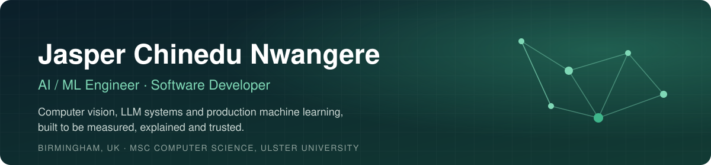

  

  
  
  

## About me

I'm a software developer and AI/ML engineer based in **Birmingham, UK**, with an **MSc in Computer Science & Technology from Ulster University**.

> 💼 **Open to opportunities** in **AI/ML engineering**, **software engineering** and **data science**.

I build end-to-end AI systems: from data pipelines and models through to APIs, interfaces and deployment. I care most about the part many projects skip: **measuring how well a system really works, and making it safe for people to rely on**. That means calibrated confidence, evidence for every output, and a human in the loop where it matters.

I'm also the sole technical founder of several live products, which I design, build, deploy and run on my own infrastructure.

- 🔭 **Focus:** computer vision, physics-informed ML, document AI, LLM applications and applied machine learning
- 🧪 **Research interest:** how reliable LLMs and ML systems are under real-world pressure
- 🚀 **Ships:** production apps on self-managed Linux servers, with Docker, Nginx and CI
- 📫 **Reach me:** via [LinkedIn](https://www.linkedin.com/in/sparobanks)

---

## Featured projects

<table>
<tr>
<td width="50%" valign="top">

### 🚗 [RepairLens](https://github.com/sparobanks/RepairLens)
Computer vision for vehicle damage assessment with a person in the loop. Outlines damage in a photo, drafts a repair estimate, and sends the photos it's unsure about to an estimator, whose corrections become training data.

Found an **84%** train/test leak in the public dataset · auto-accepts **12%** of photos at **75%** accuracy (3x the base rate)

`YOLO11` `PyTorch` `OpenCV` `FastAPI` `Streamlit`

</td>
<td width="50%" valign="top">

### ⚓ [HullForge](https://github.com/sparobanks/hullforge)
Physics-informed AI for early-stage ship hull design: a resistance solver, neural surrogates with calibrated uncertainty, generative hull design, NSGA-II optimisation and wind-assisted propulsion.

**0.2%** error on ships larger than any it trained on (black-box network: 8.5%) · **5,000x** faster than the solver

`PyTorch` `pymoo` `SciPy` `Streamlit`

</td>
</tr>
<tr>
<td width="50%" valign="top">

### 🔌 [SpecSight](https://github.com/sparobanks/specsight)
AI estimating assistant for electrical switchgear tenders. Reads engineering drawings and specs, cross-checks them, and prices the job, with a person confirming anything uncertain.

**97.9%** field accuracy · **0.4%** error on auto-accepted values · calibration error **0.365 → 0.014**

`OpenCV` `Tesseract` `scikit-learn` `FastAPI` `Docker`

</td>
<td width="50%" valign="top">

### 🧠 [The Conformity Problem](https://github.com/sparobanks/conformity-llm)
Research study: do LLMs abandon correct answers under social pressure? An Asch-style protocol tested on Claude, GPT-4o, Gemini and Llama 3.

Found Llama 3 70B conformed on **20.1%** of maths questions, with expert-authority framing the strongest driver.

`LLM evaluation` `Python` `Experimental design`

</td>
</tr>
<tr>
<td width="50%" valign="top">

### 📄 [AI Product Metadata Platform](https://github.com/sparobanks/ai-product-metadata-platform)
Ingests supplier PDFs and images, extracts structured product data with OCR fallback, validates it, and answers questions with a grounded RAG assistant that shows its evidence.

`FastAPI` `OCR` `sentence-transformers` `RAG` `PostgreSQL`

</td>
<td width="50%" valign="top">

### 📈 [AlphaForexAI](https://github.com/sparobanks/alphaforexai)
Live forex signals SaaS: market data ingestion, feature engineering, XGBoost models, a rules engine, a signals API and a dashboard with Telegram and email alerts, plus paid subscriptions.

🌐 Live: [alphaforexai.com](https://alphaforexai.com)

`XGBoost` `FastAPI` `PostgreSQL` `Next.js` `Docker`

</td>
</tr>
<tr>
<td width="50%" valign="top">

### 👁️ [Driver Drowsiness Detection](https://github.com/sparobanks/driver-drowsiness-detection-system)
Real-time driver monitoring from a webcam: detects drowsiness, yawning and distraction from facial landmarks, raises alerts, and logs events to an analytics dashboard.

`OpenCV` `MediaPipe` `Streamlit`

</td>
<td width="50%" valign="top">

### 🌫️ [Air Quality & Mortality Analysis](https://github.com/sparobanks/Air-Quality-and-Mortality-Analysis)
Big-data analysis of how air pollution and deprivation relate to mortality across areas, using Spark for processing and clear visual reporting.

`Apache Spark` `PySpark` `Pandas`

</td>
</tr>
<tr>
<td width="50%" valign="top">

### 💳 [Loan Default Prediction](https://github.com/sparobanks/Loan-Default-Prediction-Using-Machine-Learning-Streamlit-App-Included)
End-to-end credit risk model on the Home Credit dataset, from exploration and feature engineering to a Streamlit app that scores applicants in real time.

LightGBM model with **0.80 ROC-AUC**.

`LightGBM` `scikit-learn` `Pandas` `Streamlit`

</td>
<td width="50%" valign="top">

### 🗂️ [Leak-free Car Damage Dataset](https://github.com/sparobanks/car-damage-leakfree)
A cleaned re-split of a public car damage segmentation dataset. Copies of the same photo are kept together, so the test set holds only photos a model has never seen.

**3,390** images from **1,553** original photos · CC BY 4.0

`Dataset` `Data quality` `Perceptual hashing`

</td>
</tr>
</table>

**MSc research:** *Adaptive Concept Drift Detection for Financial Time Series Using Machine Learning and Online Meta-Learning.* A meta-learning detector that spotted **7.5x more** market regime changes than the best classical baseline, **19% faster**.

---

## Products I've built and run

| Product | What it is |
|---|---|
| [**Journey2UK**](https://journey2uk.com) | UK visa-sponsorship jobs and scholarships portal with automated vacancy collection, an AI-assisted editorial workflow, an MCP server for LLM clients, and Android and iOS apps |
| [**AlphaForexAI**](https://alphaforexai.com) | AI forex signals platform with XGBoost models, a public signals API, Telegram and email alerts, and Stripe subscriptions |
| [**MyStreet News**](https://mystreet.news) | Multi-country news platform with a local community layer and mobile apps (Android and iOS apps) |

All self-hosted on Linux servers I manage, with Nginx, PM2, Docker and Cloudflare.

---

## Tech stack

**AI & data**

**Backend & web**

**Deployment & ops**

---

## How I work

- **Measure honestly.** Every project gets an evaluation, including where it falls short.
- **Show the evidence.** If a model gives an answer, you should be able to see why.
- **Keep people in control.** Automate the repetitive work, and route the uncertain cases to a human.
- **Ship it.** A model in a notebook helps nobody, so I take projects through to deployment.

Thanks for visiting. I'm open to AI/ML, software engineering and data science roles, so if any of this is relevant to your team, I'd be glad to talk.

