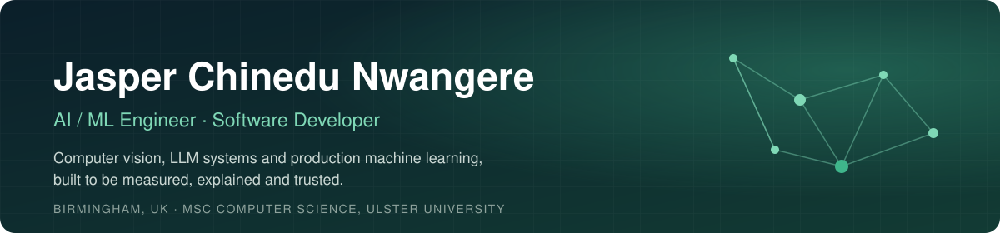

  

  
  
  

## About me

I'm a software developer and AI/ML engineer based in **Birmingham, UK**, with an **MSc in Computer Science & Technology from Ulster University** (Distinction).

> 💼 **Open to opportunities** in **AI/ML engineering**, **software engineering** and **data science**.

I build end-to-end AI systems: from data pipelines and models through to APIs, interfaces and deployment. I care most about the part many projects skip: **measuring how well a system really works, and making it safe for people to rely on**. That means calibrated confidence, evidence for every output, and a human in the loop where it matters.

I'm also the sole technical founder of three live products, which I design, build, deploy and run on my own infrastructure.

- 🔭 **Focus:** computer vision, applied machine learning, LLM applications, digital health and data engineering
- 🧪 **Research interest:** how reliable LLMs and ML systems are under real-world pressure
- 🚀 **Ships:** web and mobile apps on self-managed Linux servers, with Docker, Nginx and CI
- 📫 **Reach me:** via [LinkedIn](https://www.linkedin.com/in/sparobanks)

---

## Products I've built and run

| Product | What it is |
|---|---|
| [**Journey2UK**](https://journey2uk.com) | UK visa-sponsorship jobs and scholarships portal with automated vacancy collection, an AI-assisted editorial workflow, an MCP server for LLM clients, and Android and iOS apps with an application tracker and job alerts |
| [**MyStreet News**](https://mystreet.news) | Multi-country news platform (Nigeria and UK) with a local community section, reader-written stories, self-serve advertising with Stripe and Paystack, and Android and iOS apps |
| [**AlphaForexAI**](https://alphaforexai.com) | AI forex signals platform with XGBoost models, a public signals API, Telegram and email alerts, and Stripe subscriptions |

All self-hosted on Linux servers I manage, with Nginx, PM2, Docker and Cloudflare.

---

## Featured projects

<table>
<tr>
<td width="50%" valign="top">

### 🎮 [eSports Vision](https://github.com/sparobanks/esports-vision)
Live event detection from esports basketball video. Reads the scoreboard with a small CNN, tracks players and the ball, spots shots and scores as they happen, and feeds a calibrated in-play win probability, an integrity check and a Java live-stats service.

**29 / 29** score changes found with **0** false events, even on a poor-quality stream · confirmed in **80 ms**

`PyTorch` `OpenCV` `Java` `FastAPI` `SciPy`

</td>
<td width="50%" valign="top">

### 🏠 [CarePulse](https://github.com/sparobanks/carepulse)
AI operations prototype for home-care providers: plans which carer goes to which visit, spots staff who may be about to leave, and reads visit notes for safeguarding concerns, with a person deciding anything that matters.

Regular-carer visits up from **32%** to **69%** · retention model AUC **0.76**, well calibrated · **97.8%** safeguarding recall

`OR-Tools` `LightGBM` `SHAP` `NLP` `FastAPI`

</td>
</tr>
<tr>
<td width="50%" valign="top">

### 🩺 [RehabTrack](https://github.com/sparobanks/rehabtrack)
Digital rehabilitation platform built on FHIR. Patients log pain, exercises and a weekly function check-in; physiotherapists see a caseload with plain-English flags for who needs a call, backed by access control and a tamper-evident audit log.

Caught **24 / 24** hidden problems · **8x** fewer false alerts with a smarter pain rule · **0** WCAG 2.2 AA violations

`FHIR` `FastAPI` `Playwright` `axe-core` `Python`

</td>
<td width="50%" valign="top">

### 🏗️ [BuildCast](https://github.com/sparobanks/buildcast)
Data integration and job forecasting for a mechanical and electrical contractor. Joins four separate systems (including Business Central over OData) into one SQL database, reports KPIs in Power BI, and predicts labour and materials for new jobs.

**1,085 / 1,100** jobs matched with **0** wrong · labour estimates with about **half the error** of tender estimates

`SQL` `Power BI` `DAX` `scikit-learn` `Streamlit`

</td>
</tr>
<tr>
<td width="50%" valign="top">

### 🚗 [RepairLens](https://github.com/sparobanks/RepairLens)
Computer vision for vehicle damage assessment with a person in the loop. Outlines damage in a photo, drafts a repair estimate, and sends the photos it's unsure about to an estimator, whose corrections become training data.

Found an **84%** train/test leak in the public dataset · auto-accepts **12%** of photos at **75%** accuracy (3x the base rate)

`YOLO11` `PyTorch` `OpenCV` `FastAPI` `Streamlit`

</td>
<td width="50%" valign="top">

### ⚓ [HullForge](https://github.com/sparobanks/hullforge)
Physics-informed AI for early-stage ship hull design: a resistance solver, neural surrogates with calibrated uncertainty, generative hull design, NSGA-II optimisation and wind-assisted propulsion.

**0.2%** error on ships larger than any it trained on (black-box network: 8.5%) · **5,000x** faster than the solver

`PyTorch` `pymoo` `SciPy` `Streamlit`

</td>
</tr>
<tr>
<td width="50%" valign="top">

### 🔌 [SpecSight](https://github.com/sparobanks/specsight)
AI estimating assistant for electrical switchgear tenders. Reads engineering drawings and specs, cross-checks them, and prices the job, with a person confirming anything uncertain.

**97.9%** field accuracy · **0.4%** error on auto-accepted values · calibration error **0.365 → 0.014**

`OpenCV` `Tesseract` `scikit-learn` `FastAPI` `Docker`

</td>
<td width="50%" valign="top">

### 🧠 [The Conformity Problem](https://github.com/sparobanks/conformity-llm)
Research study: do LLMs abandon correct answers under social pressure? An Asch-style protocol tested on Claude, GPT-4o, Gemini and Llama 3.

Llama 3 70B conformed on **20.1%** of maths questions, with expert-authority framing the strongest driver.

`LLM evaluation` `Python` `Experimental design`

</td>
</tr>
<tr>
<td width="50%" valign="top">

### 📄 [AI Product Metadata Platform](https://github.com/sparobanks/ai-product-metadata-platform)
Reads supplier PDFs and scanned images, pulls out product details with confidence scores and source evidence, flags missing fields and duplicates, and makes every product searchable in plain English.

`FastAPI` `OCR` `sentence-transformers` `PostgreSQL` `Docker`

</td>
<td width="50%" valign="top">

### 🎙️ [Voice AI Portfolio](https://github.com/sparobanks/Complete-AI-Voice-Projects)
Five working speech apps, each with an API and a web app: speech-to-text, voice login, speaker diarization, and a keyword spotter and accent classifier I trained myself.

`Whisper` `SpeechBrain` `pyannote` `wav2vec2` `FastAPI`

</td>
</tr>
<tr>
<td width="50%" valign="top">

### 👁️ [Driver Drowsiness Detection](https://github.com/sparobanks/driver-drowsiness-detection-system)
Real-time driver monitoring from a webcam: tracks 478 face points to detect long eye closures, yawning and looking away, turns them into a 0 to 100 fatigue score, sounds an alarm and logs events to a dashboard.

`OpenCV` `MediaPipe` `Streamlit`

</td>
<td width="50%" valign="top">

### 🗂️ [Leak-free Car Damage Dataset](https://github.com/sparobanks/car-damage-leakfree)
A cleaned re-split of a public car damage segmentation dataset. Copies of the same photo are kept together, so the test set holds only photos a model has never seen.

**3,390** images from **1,553** original photos · CC BY 4.0

`Dataset` `Data quality` `Perceptual hashing`

</td>
</tr>
</table>

**MSc research:** *Adaptive Concept Drift Detection for Financial Time Series Using Machine Learning and Online Meta-Learning.* A meta-learning detector that spotted **7.5x more** market regime changes than the best classical baseline, **19% faster**.

### More projects

- 📊 [Customer Churn Analysis](https://github.com/sparobanks/Power-BI-Customer-Churn-Analysis): Power BI dashboard on 7,032 telecom customers, showing who leaves and the **$139K** of monthly revenue lost, with a churn prediction model.
- 💳 [Loan Default Prediction](https://github.com/sparobanks/Loan-Default-Prediction-Using-Machine-Learning-Streamlit-App-Included): LightGBM on 307,000 loan applications (ROC-AUC **0.76**), with a Streamlit scoring app and an honest look at choosing the right cut-off.
- 🌫️ [Air Pollution and Deaths](https://github.com/sparobanks/Air-Quality-and-Mortality-Analysis): Hadoop and Spark pipeline comparing PM2.5 pollution and deaths in Angola and Libya.
- 🏙️ [Social Deprivation and Mortality](https://github.com/sparobanks/Analysis-of-Social-Deprivation-Mortality-in-UK-Cities): big data analysis of deprivation against death rates across UK cities.
- 🏡 [House Price Prediction](https://github.com/sparobanks/Predicting-House-Prices-Using-Machine-Learning): four models compared on 20,640 California neighbourhoods; Random Forest explains **81%** of the variation.
- ⚽ [Premier League Manager Data Pipeline](https://github.com/sparobanks/Premier-League-Manager-Data-Pipeline-Using-Python): web scraping pipeline for all 20 Premier League managers, with data consistency tests.
- 🦠 [COVID-19 Dashboard](https://github.com/sparobanks/DAX-Power-BI-Covid19): Power BI dashboard with DAX measures.
- 🎓 [MSc Coursework](https://github.com/sparobanks/msc-coursework-portfolio): Tesla digital transformation strategy report and presentation.

---

## Tech stack

**AI & data**

**Backend & web**

**Deployment & ops**

---

## How I work

- **Measure honestly.** Every project gets an evaluation, including where it falls short.
- **Show the evidence.** If a model gives an answer, you should be able to see why.
- **Keep people in control.** Automate the repetitive work, and route the uncertain cases to a human.
- **Ship it.** A model in a notebook helps nobody, so I take projects through to deployment.

Thanks for visiting. I'm open to AI/ML, software engineering and data science roles, so if any of this is relevant to your team, I'd be glad to talk.

